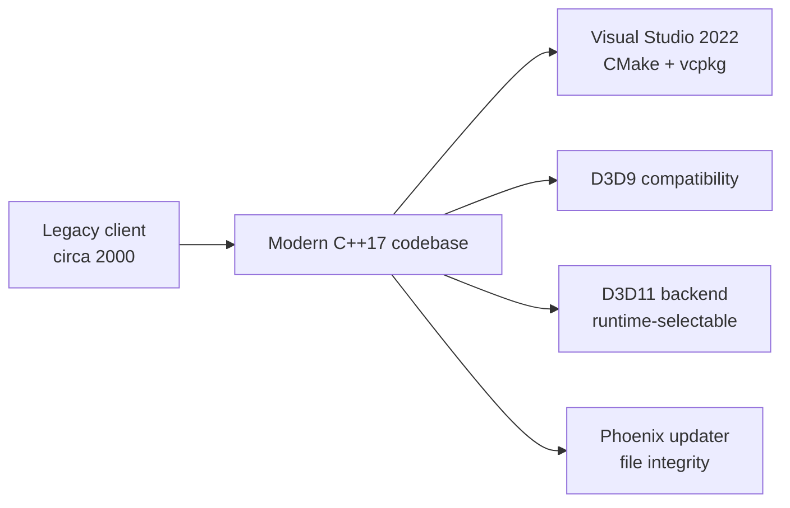

<div align="center">

# DK Project Phoenix — Client

### A legacy game client modernized for today's Windows development environment


**From 2000 to 2026:** a long-running client codebase brought forward to a modern compiler, graphics stack, and build workflow.

</div>

> [!IMPORTANT]
> This repository contains client source and build files, not game runtime data. The CMake configuration currently requires a SoLoud source checkout that is not included here; see [Known build prerequisites](#known-build-prerequisites) before configuring a clean checkout.

## ✨ Modernization at a glance

| Area | Highlights |
|---|---|
| **Toolchain** | Updated for **Visual Studio 2022**, modern MSVC, **CMake 3.20+**, and **C++17**. |
| **Operating system** | Intended to build with the Windows 11 SDK and Visual Studio 2022 C++ tools. |
| **Graphics** | Includes a **Direct3D 11 backend** alongside the Direct3D 9 compatibility renderer. D3D9 is currently the default; D3D11 can be selected at runtime. |
| **Audio** | The modernized audio path uses **SoLoud**, with WASAPI and WinMM backend support configured by the project. |
| **Dependencies** | Legacy components have been replaced or modernized where integrated, using vcpkg packages and source-built project libraries. |
| **Updater and file protection** | Adds a custom Phoenix updater, file patching, and client file-integrity checks. |
| **Custom client systems** | Project-specific UI, diagnostics, display options, and runtime improvements extend the original client. |



### Selecting the renderer

The current build defaults to **D3D9**. To select D3D11, either set `PHOENIX_RENDER_BACKEND` to `dx11`, or create a `render_backend.cfg` file beside `Client.exe` with `dx11` on its first line:

```text
dx11
```

Use `dx11gpu` to select D3D11 and its separate GPU sprite path. If no selection is provided, the client uses D3D9.

## 🧰 Requirements

- Windows 11
- Visual Studio 2022 with the **Desktop development with C++** workload:
  - MSVC v143 C++ build tools
  - Windows 10 or Windows 11 SDK
  - CMake tools for Windows
- CMake 3.20 or newer
- Git
- vcpkg
- SoLoud source at the path and tag described below

The client is configured for **32-bit Win32 / x86-windows** and requires C++17. The manifest pins its vcpkg registry baseline and declares:

`xerces-c` · `zlib` · `lzo` · `directx-headers` · `libogg` · `libvorbis` · `libjpeg-turbo` · `webview2`

## 🚀 Build on Windows

Run these commands in **Developer PowerShell for VS 2022**. The steps assume you are building the `Client` folder from this repository's `dkcommunity-build-input-ignore-audit` branch.

### 1. Clone the source

```powershell
git clone --branch dkcommunity-build-input-ignore-audit https://github.com/dkcommunity/DK-Project-Phoenix.git
Set-Location .\DK-Project-Phoenix\Client
$clientDir = (Get-Location).Path
```

### 2. Install vcpkg

If vcpkg is not already installed, bootstrap it and set `VCPKG_ROOT` for the current PowerShell session:

```powershell
git clone https://github.com/microsoft/vcpkg.git C:\src\vcpkg
Set-Location C:\src\vcpkg
.\bootstrap-vcpkg.bat
$env:VCPKG_ROOT = 'C:\src\vcpkg'
Set-Location $clientDir
```

If vcpkg is already installed, set `VCPKG_ROOT` to its existing directory instead.

### 3. Fetch the required SoLoud source

The CMake project expects the `RELEASE_20200207` checkout at `thirdparty\soloud`:

```powershell
git clone https://github.com/jarikomppa/soloud.git .\thirdparty\soloud
git -C .\thirdparty\soloud checkout RELEASE_20200207
```

### 4. Configure the Win32 build

```powershell
cmake -S . -B build `
  -G "Visual Studio 17 2022" `
  -A Win32 `
  "-DCMAKE_TOOLCHAIN_FILE=$env:VCPKG_ROOT/scripts/buildsystems/vcpkg.cmake" `
  -DVCPKG_TARGET_TRIPLET=x86-windows
```

With manifest mode, vcpkg resolves and installs the dependencies listed in `vcpkg.json` for the selected triplet during configuration.

### 5. Build the client

```powershell
cmake --build build --config Release --target Client --parallel
```

CMake writes the client executable and runtime DLLs to `GameData`. Build products and runtime data are ignored by `Client/.gitignore`.

## ⚠️ Known build prerequisites

- **SoLoud is required but not included.** The top-level CMake configuration unconditionally adds `thirdparty/soloud/contrib` and links the `soloud` target. A clean configure will fail until the source checkout is present at the expected location.
- **Legacy DirectX 7 SDK files are not included.** CMake warns if `thirdparty\dx7sdk` is missing. The source also references its legacy headers and libraries, so provide a compatible SDK there if configuration or compilation reports missing DirectX 7 files.
- **Clean-build status:** the steps above describe the intended setup, but a clean checkout has not yet been verified end to end. Build success depends on the required local SDK files and a complete toolchain installation.

## 📁 Source layout

```text
Client/
├── CMakeLists.txt                  # Top-level CMake configuration
├── vcpkg.json                      # Pinned dependency manifest
├── Designed_Chs/                   # Client target and CHS project files
├── Designed_Common/                # Shared client code and libraries
├── thirdparty/
│   ├── imgui/                       # Vendored UI library
│   ├── unrar/                       # Vendored UnRAR source
│   └── soloud/                      # Required local checkout; not included
├── tools/PhoenixMiniDumper/         # Client diagnostic helper
└── GameData/                        # Local runtime/build output directory
```

## 📜 Third-party notices

Third-party components retain their own licenses and usage terms. Review the license files in each dependency directory before redistribution. In particular, consult `thirdparty\unrar\unrar\license.txt` for UnRAR restrictions.

---

<div align="center">

**DK Project Phoenix Client · 2000 → 2026**

</div>
