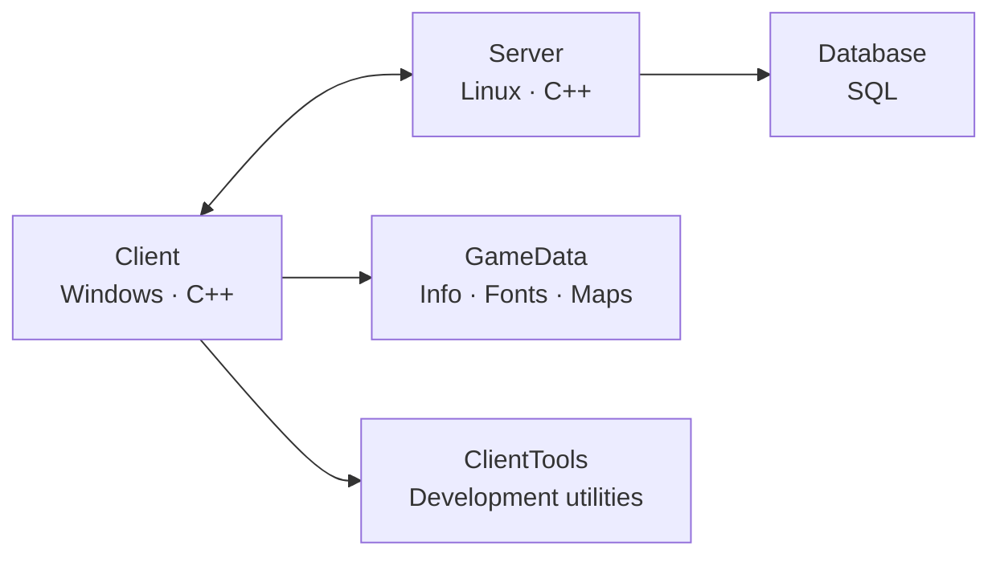

<div align="center">

# DK Project Phoenix

### The game client, server, database, runtime data, and tools in one place


**Explore each part of the project, from the modernized Windows client to the Linux server and game data.**

</div>

## 📦 Project components

| Component | Description | Explore |
|---|---|---|
| **Client** | Modernized Windows game client, updated for Visual Studio 2022 and CMake, with Direct3D 11 support. | [Client source](Client/) · [Build guide](Client/README.md) |
| **Server** | Linux C++ game-server services, optional service tools, and deployment documentation. | [Server source](Server/) · [Build guide](Server/README.md) |
| **Database** | MySQL-compatible database dumps and SQL scripts for the Phoenix server. | [Database files](Database/) |
| **GameData** | Client runtime assets, including configuration and game information files, fonts, and maps. | [GameData](GameData/) · [Information files](GameData/data/info/) · [Fonts](GameData/data/font/) · [Maps](GameData/data/map/) |
| **ClientTools** | A compressed archive of standalone tools for client maintenance and development. | [Tools archive](ClientTools/tools.7z) · [ClientTools](ClientTools/) |



## 🗂️ Repository layout

```text
DK-Project-Phoenix/
├── Client/                  # Windows game client and build guide
├── Server/                  # Linux game server and build guide
├── Database/                # Database dumps and SQL scripts
├── GameData/
│   └── data/
│       ├── info/             # Client configuration and game definitions
│       ├── font/             # Client font resources
│       └── map/              # Client map resources
└── ClientTools/
    └── tools.7z              # Compressed client development tools
```

## 🚀 Getting started

- To build the **Client**, start with the [Windows build guide](Client/README.md).
- To build the **Server**, start with the [Linux build guide](Server/README.md).
- Review the **Database** scripts and configure them for your own environment before use.
- The **GameData** and **ClientTools** directories provide runtime assets and utilities; see their contents and documentation before distributing them.

> [!NOTE]
> The repository is organized into separate components. Each component may have its own dependencies, setup requirements, and usage terms. Review its documentation and third-party notices before building or redistributing files.
