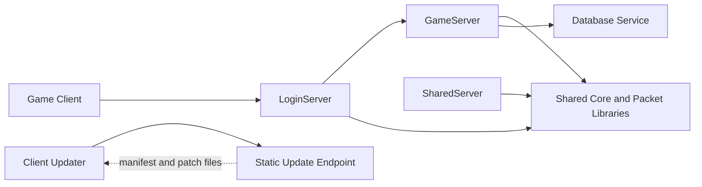

<div align="center">

# DK Project Phoenix — Server

### The Linux server stack behind the classic MMORPG


**DK Project Phoenix Server** contains the legacy C++ server code and supporting service tools for the game. The core Makefile builds the server libraries and the principal game, login, and shared server components on Linux.

</div>

> [!IMPORTANT]
> This folder is a source-code snapshot. It does not include the ignored `lib/` build outputs or `sql/` files. Database setup files and production configuration must be obtained and configured separately. The Makefiles also contain legacy dependency paths; review [Build prerequisites](#build-prerequisites) before starting a fresh build.

## ✨ What's inside

| Component | Role |
|---|---|
| **Core** | Shared C++ types, networking, packet handling, serialization, and common server libraries. |
| **GameServer** | Gameplay, world, player, item, skill, quest, and event systems. |
| **LoginServer** | Client login and server selection services. |
| **SharedServer** | Shared game-service coordination. |
| **Database and billing** | Database integration and billing components used by the server targets. |
| **Update endpoint tools** | Scripts and examples for publishing client update manifests as static files. |
| **PayPal service** | An optional Python/FastAPI service maintained alongside the C++ servers. It is not part of the default Make build. |
| **Runtime data** | The tracked `data/` directory contains server-side data such as quest definitions. |



## 🧰 Build prerequisites

The C++ server uses GNU Make and `g++` with Linux-specific compile definitions. The Makefiles request C++11 and link against MySQL-compatible client libraries, Xerces-C, Lua 5.1, OpenSSL, zlib, zstd, ICU, FreeTDS, and POSIX system libraries.

On Debian or Ubuntu, the following packages provide a starting point:

```bash
sudo apt update
sudo apt install \
  build-essential \
  g++ \
  make \
  libxerces-c-dev \
  liblua5.1-0-dev \
  libssl-dev \
  zlib1g-dev \
  libzstd-dev \
  libicu-dev \
  libmariadb-dev \
  libmariadb-dev-compat \
  freetds-dev
```

Package names may differ on other distributions. The server Makefiles currently refer to legacy paths including:

- MySQL headers and libraries under `/usr/local/mysql/`
- Lua 5.1 libraries under `/usr/local/lua-5.1.3/lib`
- Xerces-C under `/usr/local/lib/xerces-c`
- Lua headers under `/usr/include/lua5.1`

If your distribution installs these dependencies elsewhere, adjust the relevant Makefile variables and include/library paths, or provide compatible development files at the expected paths. The current Makefiles are not a portable, auto-detecting build system.

## 🚀 Build on Linux

### 1. Clone the repository and enter the server directory

```bash
git clone --branch dkcommunity-build-input-ignore-audit \
  https://github.com/dkcommunity/DK-Project-Phoenix.git
cd DK-Project-Phoenix/Server
```

### 2. Install and verify dependencies

Install the packages listed above, then confirm that the required MySQL-compatible, Xerces-C, Lua, OpenSSL, zlib, zstd, ICU, and FreeTDS headers and libraries are available at the paths used by the Makefiles.

The build requires the database development files; a running database is not needed merely to compile. Database credentials and production service settings should be supplied locally and must not be committed.

### 3. Build the default server targets

```bash
make -C src -j"$(nproc)"
```

The root `src/Makefile` builds the common Core libraries and then invokes the server Makefile. By default, it builds the database and billing components along with the GameServer, LoginServer, and SharedServer. The UpdateServer has its own Makefile target but is not included in the default `all` target.

The Makefiles place generated executables and artifacts in `bin/`, `lib/`, `log/`, and `temp/` at the `Server/` root. These generated directories and object files are excluded from Git; `make` recreates build outputs from source.

### 4. Clean generated outputs

```bash
make -C src clean
```

Use the Makefiles' `cleanall` target only when you intend to remove all generated binaries and libraries.

## 🧩 Optional services

The default C++ build does **not** install or start the adjacent service tools.

- **Phoenix update endpoint:** `tools/phoenix_updates/README.md` documents the Nginx static update endpoint and release publishing scripts. Production deployments should use HTTPS and protect the manifest signing private key.
- **PayPal service:** `paypal_service/requirements.txt` lists its Python dependencies. Configure its environment locally from `.env.example`; do not commit real credentials.

## 📁 Repository layout

```text
Server/
├── data/                       # Server-side data and quest definitions
├── paypal_service/             # Optional Python payment service
├── src/
│   ├── Core/                   # Shared server and packet libraries
│   └── server/
│       ├── gameserver/
│       ├── loginserver/
│       ├── sharedserver/
│       └── updateserver/
├── tools/
│   ├── phoenix_updates/        # Update endpoint and publish tooling
│   └── security/               # Supporting security utilities
├── README.md
└── .gitignore
```

## 🚫 Excluded from this repository

The following paths are intentionally kept out of the GitHub source snapshot:

```text
graphify-out/
lib/
sql/
tools/teleport/
tools/gdr/
tools/discordbot/
tools/dklunox_home/
tools/dklunoxdiscordAI/
```

The `lib/` directory contains generated static libraries that the Makefiles can rebuild. SQL scripts and the excluded tools are not part of this source snapshot; obtain any database migrations or operational tools you need through the project's authorized distribution.

## 📜 Third-party notices

Review the individual license and attribution files for included third-party code before redistributing source or binaries.

---

<div align="center">

**DK Project Phoenix Server · Linux · C++**

</div>
