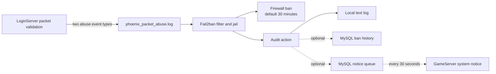

<div align="center">

# Phoenix Server Security Tools

### Fail2ban protection for suspicious LoginServer packet traffic


This directory contains a Fail2ban jail, a packet-abuse log filter, an optional audit action, and an installer for the Phoenix LoginServer.

</div>

## What it does

The protection is driven by server log events rather than packet inspection by Fail2ban itself:

1. **LoginServer detects protocol anomalies.** `LoginPlayer.cpp` writes `event=too_large_packet_id` when a packet ID is outside the supported range and `event=login_invalid_packet_order` when a packet is not valid for the player's current protocol state. These events are written to `phoenix_packet_abuse.log`.
2. **Fail2ban watches that log.** `fail2ban/filter.d/phoenix-login-abuse.conf` matches those two event names. Ordinary disconnects and `ConnectException` messages are not matched.
3. **The jail applies a temporary firewall ban.** The default policy bans an IP after 5 matching events within 60 seconds for 1,800 seconds (30 minutes), on TCP port `9999`. The default action is `nftables-multiport`.
4. **The custom action records the result.** `phoenix-db-audit.conf` invokes `phoenix_fail2ban_audit.sh` on ban and unban. The script always attempts a local text audit and can optionally write ban history to MySQL and queue a game notice.
5. **GameServer can broadcast queued notices.** When the optional database queue is configured and the server's `SecurityNoticeManager` is running, GameServer polls `SecurityNoticeQueue` every 30 seconds, broadcasts up to five unprocessed messages, and marks them processed.



## Files

| Path | Purpose |
|---|---|
| `install_packet_abuse_fail2ban.sh` | Installs the filter, jail, audit action, and example database configuration; enables and restarts Fail2ban. |
| `fail2ban/filter.d/phoenix-login-abuse.conf` | Matches only the two LoginServer packet-abuse log events. |
| `fail2ban/jail.d/phoenix-login-abuse.local` | Sets the log path, port, retry threshold, ban duration, ignored networks, firewall action, and audit action. |
| `fail2ban/action.d/phoenix-db-audit.conf` | Calls the audit script when Fail2ban bans or unbans an address. |
| `phoenix_fail2ban_audit.sh` | Writes text audit records and optionally writes database records and queues a game notice. |
| `security-db.conf.example` | Example configuration sourced by the audit script. Copy it to `/etc/phoenix/security-db.conf` and protect it with mode `0600`. |

## Requirements

- Linux with `systemd` and `systemctl` (the installer enables and restarts the `fail2ban` service).
- Bash and standard utilities used by the installer: `install`, `cp`, `sed`, `mktemp`, `chmod`, and `chown`.
- Fail2ban, including the filter/jail/action configuration directories.
- A firewall backend supported by Fail2ban. The default is `nftables-multiport`; use `iptables-multiport` if the host is configured for legacy iptables.
- A running Phoenix LoginServer that emits the expected events to the configured log file.
- Root privileges to install files under `/etc/fail2ban`, `/etc/phoenix`, and `/usr/local/sbin`, and to restart Fail2ban.

Optional database auditing and in-game notices additionally require:

- The MySQL command-line client and network or local access to the configured database.
- A database account with permission to insert/update the security audit and notice tables.
- The `SecurityBanLog` and `SecurityNoticeQueue` tables. The server-side notice consumer also needs the columns it reads and updates (`ID`, `Message`, `Processed`, and `ProcessedAt`).
- A GameServer build and database configuration that include and run `SecurityNoticeManager`.

> [!WARNING]
> The SQL schema file referenced by the installer, `sql/security_ban_tables.sql`, is not included in this repository snapshot because `sql/` is excluded. As a result, setting `PHOENIX_SECURITY_DB_PASS` makes the installer attempt to load a file that is absent and can cause installation to stop. The database tables must be obtained from the project's authorized source and installed separately; do not enable the installer’s database-provisioning branch until the schema is available.

## Installation

Run these steps on the Linux server from this directory. The examples assume the repository is installed at `/home/phoenix/phoenix/Server`.

### 1. Install Fail2ban and the firewall backend

On Debian or Ubuntu:

```bash
sudo apt update
sudo apt install fail2ban nftables
```

If the host uses legacy iptables instead, install and configure the appropriate iptables packages and use the `iptables-multiport` Fail2ban action.

### 2. Confirm the LoginServer log directory

The checked-in jail and installer currently default to the legacy path:

```text
/home/phoenix/phoenix/ServerSRC/bin/log
```

The repository is now laid out under `Server/`. Before starting Fail2ban, determine where the running LoginServer actually writes `phoenix_packet_abuse.log`. Create that directory if necessary and update `logpath` in `fail2ban/jail.d/phoenix-login-abuse.local` to the exact file path. For example, if the service writes under the current `Server` layout:

```ini
logpath = /home/phoenix/phoenix/Server/bin/log/phoenix_packet_abuse.log
```

The installer does not rewrite `logpath`; setting `PHOENIX_SECURITY_LOG_DIR` only changes the directory in which it creates the log file. The LoginServer's own logging destination and the jail's `logpath` must agree.

### 3. Review the jail settings

Before installing, review `fail2ban/jail.d/phoenix-login-abuse.local`:

- Confirm `port = 9999` matches the LoginServer's actual listening port.
- Preserve the local/private network exclusions and add trusted fixed administrator IP addresses to `ignoreip`.
- Keep the default threshold and duration unless you have an operational reason to change them.
- Confirm `banaction` matches the host firewall. Ubuntu 22.04+ commonly uses `nftables-multiport`; older or legacy iptables hosts may require `iptables-multiport`.

You can override the firewall action and append extra ignored IPs when running the installer:

```bash
sudo env \
  PHOENIX_FAIL2BAN_BANACTION=nftables-multiport \
  PHOENIX_FAIL2BAN_IGNOREIP="203.0.113.10 2001:db8::10" \
  ./install_packet_abuse_fail2ban.sh
```

Replace the example addresses with your own trusted addresses. Do not copy documentation-only IP ranges into production configuration.

### 4. Install the Fail2ban integration

```bash
chmod +x install_packet_abuse_fail2ban.sh phoenix_fail2ban_audit.sh
sudo ./install_packet_abuse_fail2ban.sh
```

The installer:

- Creates the Fail2ban configuration directories and `/etc/phoenix`.
- Creates the packet-abuse log file and sets its permissions.
- Installs the filter, custom audit action, jail, and audit script.
- Copies `security-db.conf.example` to `/etc/phoenix/security-db.conf` only if that file does not already exist, with mode `0600`.
- Enables and restarts Fail2ban, then displays the jail status.

The installer defaults `PHOENIX_SERVER_USER` to `phoenix` when setting log ownership. Set it if the server runs under a different account:

```bash
sudo env PHOENIX_SERVER_USER=phoenix ./install_packet_abuse_fail2ban.sh
```

If you change the checked-in jail file after an installation, copy the updated file to `/etc/fail2ban/jail.d/phoenix-login-abuse.local` and restart Fail2ban:

```bash
sudo install -m 0644 fail2ban/jail.d/phoenix-login-abuse.local \
  /etc/fail2ban/jail.d/phoenix-login-abuse.local
sudo fail2ban-client -t
sudo systemctl restart fail2ban
```

## Optional MySQL audit and in-game notices

The firewall ban does not depend on MySQL. Without a usable database configuration, the audit script still attempts to append records to `phoenix_security_ban.log`; database audit operations are skipped or logged locally if the MySQL client is unavailable or the database operation fails.

To configure the database integration:

1. Obtain and apply the required table schema from the project's authorized database distribution. The schema is not present in this repository snapshot.
2. Edit `/etc/phoenix/security-db.conf` with the correct `DB_HOST`, `DB_NAME`, `DB_USER`, and `DB_PASS`. Do not commit this file or expose it to untrusted users; keep permissions at `0600`.
3. Set `NOTICE_QUEUE=1` to enable queued game notices, or `NOTICE_QUEUE=0` for database audit only.
4. Set an appropriate `NOTICE_COOLDOWN_SECONDS` and `NOTICE_MESSAGE`. The audit action queues at most one notice per cooldown window.
5. Confirm GameServer uses the same database and that `SecurityNoticeManager` is running.

The custom audit script sanitizes the remote IP to hexadecimal, digits, colon, and dot characters before issuing SQL, and escapes single quotes in other inserted text. Database access is best-effort: the firewall ban remains Fail2ban's responsibility.

## Verification and operations

Check that Fail2ban parsed the configuration and that the jail is active:

```bash
sudo fail2ban-client -t
sudo fail2ban-client status
sudo fail2ban-client status phoenix-login-abuse
sudo systemctl status fail2ban --no-pager
```

Inspect the configured log file and local audit output:

```bash
sudo tail -f /home/phoenix/phoenix/Server/bin/log/phoenix_packet_abuse.log
sudo tail -f /home/phoenix/phoenix/Server/bin/log/phoenix_security_ban.log
```

Use the actual log directory configured for your installation. If `fail2ban-regex` is installed, the installer also tests the current log against the filter, but that test is allowed to fail during installation (`|| true`).

## Configuration reference

| Setting | Default | Description |
|---|---|---|
| `PHOENIX_SECURITY_LOG_DIR` | `/home/phoenix/phoenix/ServerSRC/bin/log` | Directory where the installer creates `phoenix_packet_abuse.log`; it does not change the jail's configured `logpath`. |
| `PHOENIX_SERVER_USER` | `phoenix` | Account used for the packet-abuse log file ownership. |
| `PHOENIX_FAIL2BAN_BANACTION` | `nftables-multiport` | Firewall action written into the installed jail. |
| `PHOENIX_FAIL2BAN_IGNOREIP` | unset | Additional trusted addresses appended to the default ignored networks. |
| `PHOENIX_SECURITY_DB_CONF` | `/etc/phoenix/security-db.conf` | Audit script configuration file path. |
| `PHOENIX_SECURITY_DB_PASS` | unset | Activates the installer's database setup branch; that branch currently expects the excluded SQL schema file and is unavailable from this snapshot. |

## Operational cautions

- This is a conservative signal-based rule, not a general DDoS mitigation system. It only reacts to the two protocol-abuse events matched by the filter.
- Incorrect log paths, missing LoginServer log events, or a firewall action incompatible with the host will prevent expected bans. Verify each layer before relying on it.
- Test rule changes on a server where you have console or out-of-band access, and ensure administrator IPs are excluded before enabling the jail.
- Database audit and broadcast features are optional and are not ready for a clean install from this repository alone because the required SQL schema is excluded.
